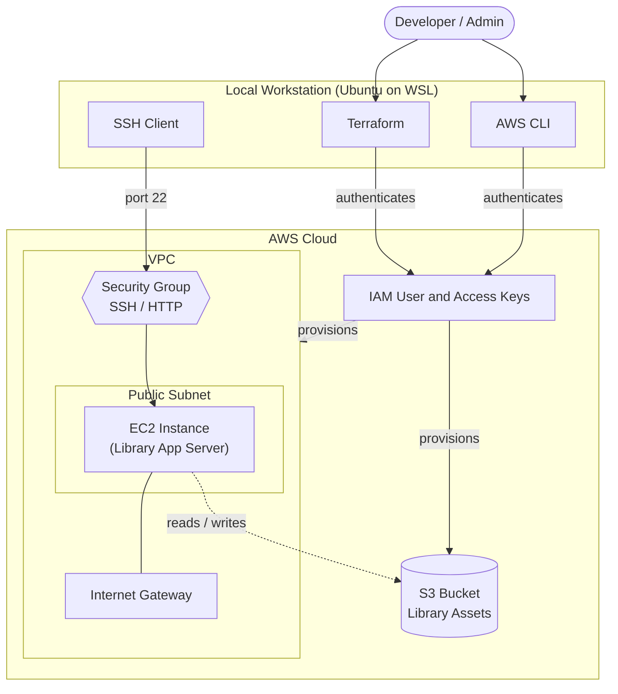
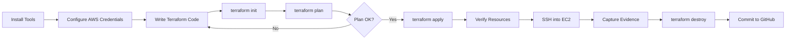
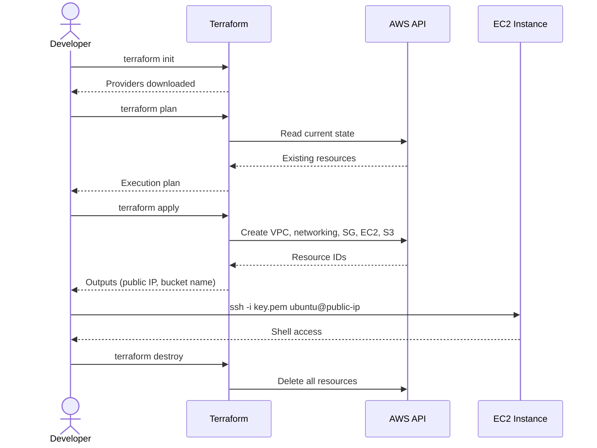
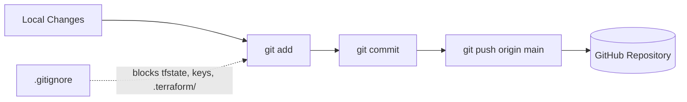
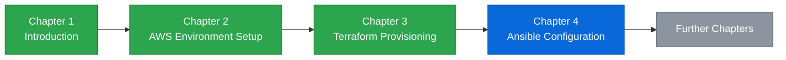
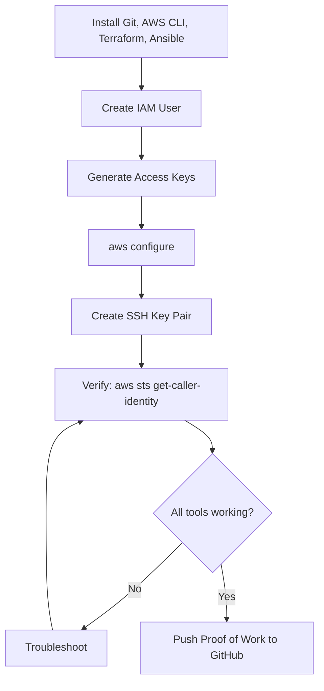
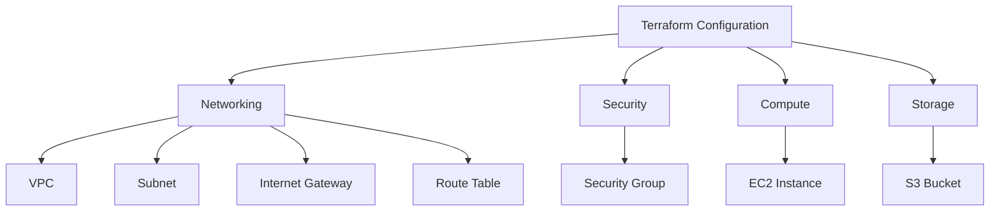
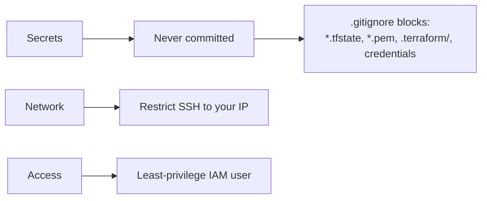
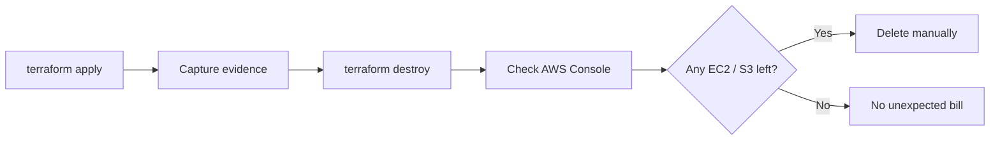
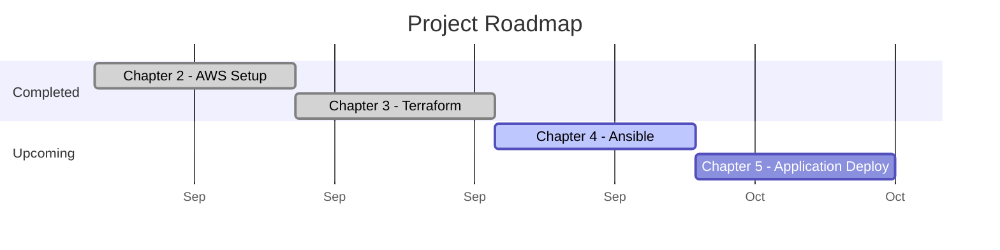

# Enterprise Smart Library Management Platform: DevOps Hands-On Lab


-E95420?logo=ubuntu&logoColor=white)


A hands-on DevOps lab that builds the infrastructure for a Smart Library Management Platform on AWS, using the AWS CLI, Terraform and Ansible. Each chapter is a self-contained, reproducible stage, with a written report.

---

## Table of Contents

1. [Project Overview](#project-overview)
2. [Architecture](#architecture)
3. [Workflow](#workflow)
4. [Repository Structure](#repository-structure)
5. [Tools and Prerequisites](#tools-and-prerequisites)
6. [Chapter Status](#chapter-status)
7. [Chapter 2: Prerequisites and AWS Environment Setup](#chapter-2-prerequisites-and-aws-environment-setup)
8. [Chapter 3: Infrastructure as Code with Terraform](#chapter-3-infrastructure-as-code-with-terraform)
9. [Security Practices](#security-practices)
10. [Cost Control](#cost-control)
11. [Roadmap](#roadmap)

---

## Project Overview

| Item | Detail |
|---|---|
| Goal | Provision and configure cloud infrastructure for a library platform using DevOps practices |
| Cloud | Amazon Web Services (AWS) |
| IaC | Terraform |
| Configuration Management | Ansible (upcoming) |
| Dev Environment | Ubuntu on WSL2 (Windows) |
| Approach | Chapter-wise labs: setup, provision, configure, verify, destroy |

---

## Architecture

Target infrastructure provisioned in Chapter 3:



---

## Workflow

End-to-end lab lifecycle followed in every chapter:



### Terraform Execution Sequence



### CI/Version Control Flow



---

## Repository Structure

```text
library-platform-devops/
├── README.md
├── .gitignore
├── Unit 4 Document 1/
│   ├── screenshots/
│   └── Chapter-2-Professional-Report.docx
└── Unit 4 Document 2/
    ├── screenshots/
    ├── terraform/
    │   ├── main.tf
    │   ├── variables.tf
    │   ├── outputs.tf
    │   ├── providers.tf
    │   └── .terraform.lock.hcl
    └── Chapter-3-Terraform-Report.docx
```

> Adjust file names above if your `.tf` files are named differently.

---

## Tools and Prerequisites

| Tool | Purpose |
|---|---|
| AWS CLI | Authenticate and interact with AWS from the terminal |
| Terraform | Declarative infrastructure provisioning |
| Ansible | Configuration management (Chapter 4) |
| Git and GitHub | Version control and proof of work |
| Ubuntu (WSL2) | Linux development environment |
| SSH key pair | Secure access to EC2 |

Verify installations:

```bash
aws --version
terraform -version
ansible --version
git --version
```

---

## Chapter Status



| Chapter | Topic | Status |
|---|---|---|
| 2 | Prerequisites and AWS Environment Setup | Completed |
| 3 | Infrastructure as Code with Terraform | Completed |
| 4 | Configuration Management with Ansible | Planned |

---

## Chapter 2: Prerequisites and AWS Environment Setup



**Outcomes**

- Required tooling installed and verified
- IAM user created with programmatic access
- AWS CLI configured and tested
- SSH key pair created for EC2 access
- `.gitignore` configured to protect secrets

---

## Chapter 3: Infrastructure as Code with Terraform

Provisions the base infrastructure for the platform using Terraform.



> Keep this diagram in sync with your actual `main.tf` (add or remove nodes as needed).

### Run the Lab

```bash
cd "Unit 4 Document 2/terraform"

terraform init
terraform fmt
terraform validate
terraform plan
terraform apply
```

Read outputs and connect:

```bash
terraform output
ssh -i ~/.ssh/<your-key>.pem ubuntu@<public-ip>
```

Clean up when finished:

```bash
terraform destroy
```

### Variables

| Variable | Description |
|---|---|
| `region` | AWS region for deployment |
| `instance_type` | EC2 instance size |
| `key_name` | Name of the SSH key pair |
| `bucket_name` | Globally unique S3 bucket name |

> Update this table to match your `variables.tf`.

---

## Security Practices



- `terraform.tfstate` and `*.pem` files are excluded via `.gitignore`
- Access keys are never stored in the repository
- SSH access should be limited to a known IP range
- IAM permissions follow least privilege
- No personal details are published in this public repository

---

## Cost Control



Always run `terraform destroy` after finishing a lab and confirm in the AWS Console that no EC2 instances or S3 buckets remain.

---

## Roadmap



> Adjust dates to your real timeline, or delete the Gantt block if not needed.

- [x] Chapter 2: AWS environment setup
- [x] Chapter 3: Terraform infrastructure
- [ ] Chapter 4: Ansible configuration management
- [ ] Chapter 5: Application deployment

---

## Reports

Detailed written reports for each chapter are available in their respective chapter folders.

---

## License

This project is for educational purposes.
